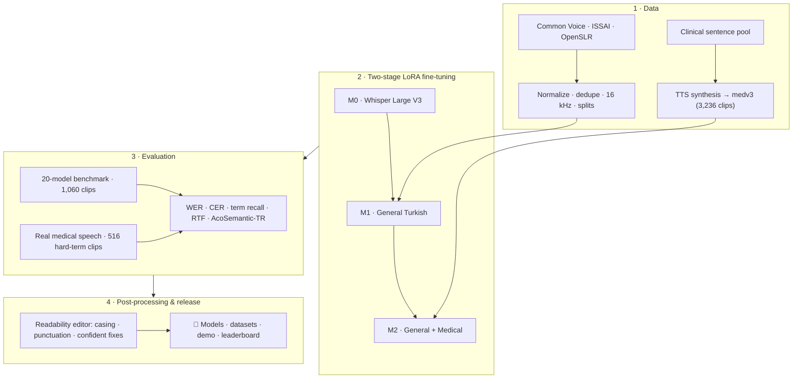
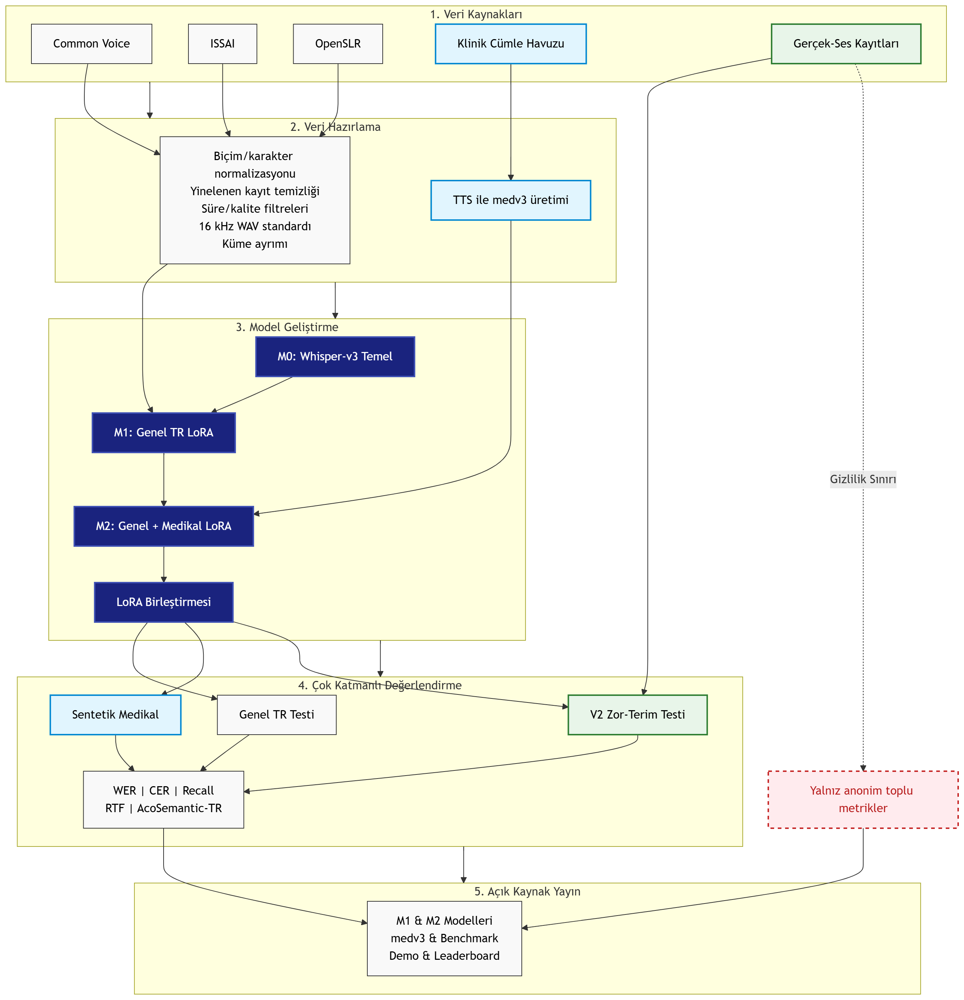
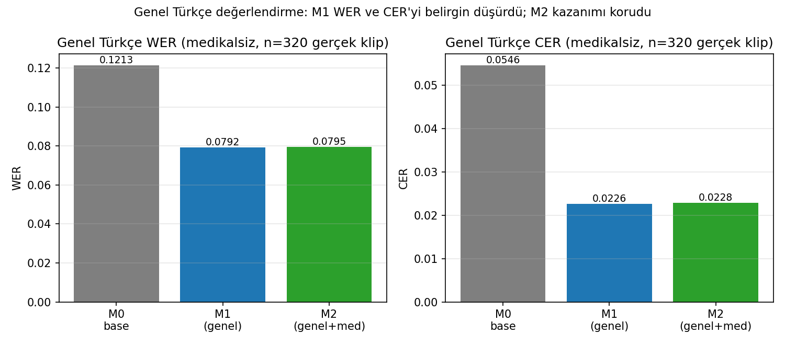
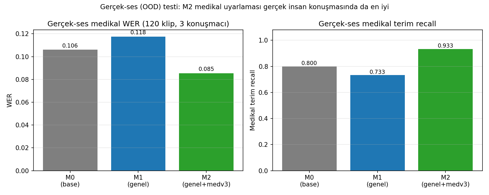

# TurkMedSTT

<p>
  
  
  
  
  <a href="https://huggingface.co/turkmedstt"></a>
</p>

> **Turkish general & medical automatic speech recognition (ASR).** Two Whisper Large V3
> models fine-tuned with LoRA, a 20-model benchmark under a shared evaluation protocol,
> an AcoSemantic semantic-preservation metric, and an ASR readability post-processor.

TurkMedSTT is a graduation project that studies Turkish automatic speech recognition
across both general and medical domains. It develops two Whisper Large V3–based models,
compares 20 open ASR models under a shared evaluation protocol, and — beyond word/character
error rates — applies an **AcoSemantic** evaluation that measures semantic and affective
preservation of ASR output.

## Pipeline



<details>
<summary>Detailed system architecture (Turkish)</summary>



</details>

## Team

- Muhammed Kumcu — [@muhammedkumcu](https://github.com/muhammedkumcu)
- Nur Yağmur Tuncer — [@yagmurtncr](https://github.com/yagmurtncr)

Advisor: Assoc. Prof. Dr. Ayşe Berna Altınel Girgin

## Key Deliverables

- **M1 — General Turkish model:** LoRA fine-tuning on general Turkish data
- **M2 — Medical Turkish model:** a second-stage LoRA fine-tune on top of M1 using both
  general and medical data
- **medv3 dataset:** 3,236 synthetic Turkish medical speech recordings
- **General Turkish benchmark:** 20 models, 1,060 clips, and 21,200 model–clip results
- **AcoSemantic evaluation:** complementary metrics measuring semantic and affective
  preservation in ASR output
- **ASR readability post-processor:** V1 General and V2 Medical models that apply casing,
  punctuation and confident word corrections after ASR
- **Demo & leaderboard:** Hugging Face Space apps to try the models and filter the results

## Highlight Results

On an independent 320-clip general Turkish evaluation, M1 reduced WER from 0.1213 to 0.0792
and CER from 0.0546 to 0.0226 versus the base model — a relative improvement of **34.7% WER**
and **58.6% CER**. M2 preserved these general-language gains.

| Model | WER ↓ | CER ↓ |
|---|---|---|
| M0 · Whisper Large V3 (base) | 0.1213 | 0.0546 |
| M1 · General Turkish | **0.0792** (−34.7%) | **0.0226** (−58.6%) |
| M2 · General + Medical | 0.0795 | 0.0228 |

<sub>Independent general Turkish test set, n = 320 real clips. Lower is better.</sub>



On a hard medical-term test of 516 real speech recordings (distinct from the training
sentences), M2 produced lower WER than the base model for all three speakers. In the pooled
paired bootstrap analysis, the M0–M2 WER gap is 0.0203, with a 95% confidence interval of
[0.0122, 0.0284] and p < 0.0001.



<sub>Separate out-of-domain real-speech test (120 clips, 3 speakers): M2 has the lowest WER (0.085) and the highest medical-term recall (0.933).</sub>

See [Results](docs/RESULTS.md) for detailed tables and evaluation caveats.

## Publications

- N. Y. Tuncer, M. Kumcu, A. B. Altınel, M. Pınar. **TurkMedSTT: Parameter-Efficient Turkish Clinical Speech
  Recognition via Synthetic Data.** *10th International Artificial Intelligence and Data Processing Symposium
  (IDAP 2026)*, 2026.

## Hugging Face Releases

- [TurkMedSTT organization](https://huggingface.co/turkmedstt)
- [M1 — General Turkish model](https://huggingface.co/turkmedstt/whisper-large-v3-turkish-general)
- [M2 — Medical Turkish model](https://huggingface.co/turkmedstt/whisper-large-v3-turkish-medical)
- [medv3 medical dataset](https://huggingface.co/datasets/turkmedstt/medv3-turkish-medical-asr)
- [General Turkish benchmark data](https://huggingface.co/datasets/turkmedstt/turkish-asr-benchmark)
- [ASR demo](https://huggingface.co/spaces/turkmedstt/turkmedstt-demo)
- [Interactive leaderboard](https://huggingface.co/spaces/turkmedstt/turkish-asr-leaderboard)
- [V1 General Turkish post-processor](https://huggingface.co/turkmedstt/turkish-asr-readability-postprocessor-v1)
- [V2 Medical post-processor](https://huggingface.co/turkmedstt/turkish-medical-asr-readability-postprocessor-v2)

Model weights, audio recordings and published data files are **not** duplicated here to keep
the repository lean — access them via the Hugging Face links above.

## Repository Structure

```text
apps/                 Hugging Face demo and leaderboard apps
configs/              Final benchmark model list
docs/figures/         System diagrams and key result charts
docs/thesis/          Final graduation report (DOCX and PDF)
docs/presentation/    Project presentation (PPTX)
results/              Benchmark, fine-tuning and real-speech result summaries
scripts/              Data preparation, training, evaluation and release scripts
postprocessing/       Turkish ASR readability post-processing model and results
static/               Static files for the local FastAPI interface
turkmed_stt/          Main Python package
```

## Readability Post-Processing

The `postprocessing/` module contains a single-checkpoint multi-task token editor that makes
raw ASR output more readable without freely rewriting it.

General Turkish V1 lowered the test WER from `0.06179` to `0.04277`. Medical V2 lowered WER
from `0.31106` to `0.18352` on controlled medical-text corruptions. V2 has **not** yet been
validated on real medical ASR output.

See the [post-processing README](postprocessing/README.md) and the
[final results](postprocessing/reports/RESULTS.md) for details.

## Local Setup

Python 3.9 or newer is recommended. GPU evaluation and training require a CUDA-compatible
PyTorch installation.

```powershell
python -m venv .venv
.\.venv\Scripts\Activate.ps1
python -m pip install --upgrade pip
pip install -r requirements.txt
```

Local FastAPI app:

```powershell
uvicorn turkmed_stt.app:app --reload
```

Hugging Face demo app:

```powershell
pip install -r apps/demo/requirements.txt
python apps/demo/app.py
```

The benchmark scripts expect a manifest that points to local audio files. Since the audio is
not included in this repository, adjust the manifest paths to your own data location. Command
examples and methodology notes are in [Reproducibility](docs/REPRODUCIBILITY.md).

## Not Included in the Repository

- Raw and processed audio recordings
- The Whisper base model, LoRA adapters and merged model weights
- Personal information, access keys and machine-specific files
- Intermediate reports, temporary experiment outputs, caches and duplicate documents

## Ethics & Scope of Use

This work is for research and educational purposes. The models are **not** a medical device
and must not be used for clinical decision-making, diagnosis or treatment without validation.
ASR output should be reviewed by a human, especially for drug names, dosages, numbers and
specialized medical terms.

## License & Citation

The source code is released under the MIT License. Model and dataset licenses are stated on
their respective Hugging Face pages. For academic use, please cite the information in
[`CITATION.cff`](CITATION.cff).

This consolidated repository preserves the core TurkMedSTT work from
[`muhammedkumcu/turkmedstt`](https://github.com/muhammedkumcu/turkmedstt) and extends it with
the readability post-processing module.
